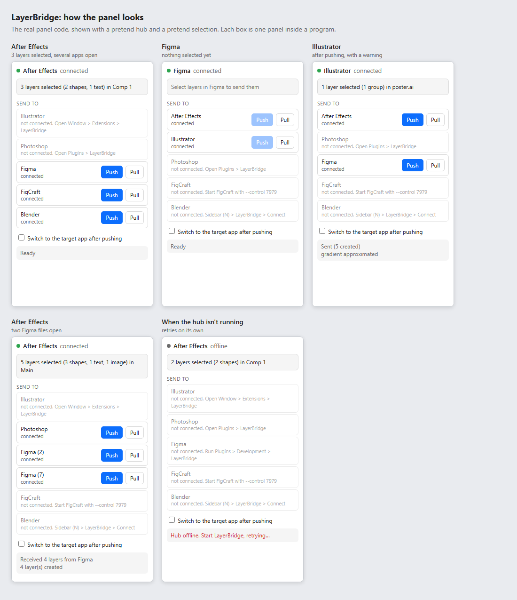

# LayerBridge

Move layers between design and motion apps on your own computer: **After Effects, Illustrator,
Photoshop, Figma, Blender and FigCraft**. Select layers in one app, pick where they should go, press
Push.

Everything runs locally. A small hub on `127.0.0.1` passes messages between one plugin per app.

> Independent project. It is not affiliated with or derived from Overlord / Battle Axe, Inc. It was
> designed from public documentation and from observing how the apps' own plugin APIs behave.

**Status: early.** Tested against real software: the hub, FigCraft and Blender. Written but **not yet
run inside** After Effects, Illustrator, Photoshop or Figma, so expect fixes on first load.

## What it looks like



Every panel shows what you have selected, then lists the other apps. Open apps get **Push** and **Pull**
buttons (Push is greyed out until something is selected); apps that aren't open are greyed out with how
to connect them.

This picture is the real panel code running with a pretend hub and a pretend selection. To see it
yourself, open `preview/index.html` in a browser. The real panels sit inside each program, so window
frames and fonts differ, and the light/dark colours follow the program's theme.

## How it works

```
Figma ─┐
After Effects ─┤
Illustrator ───┼── hub (WebSocket :61804, TCP :61805) ── FigCraft (its --control socket)
Photoshop ─────┤
Blender ───────┘            status page: http://127.0.0.1:61806
```

Layers travel in one neutral JSON format (paths, gradients, strokes, blend modes, rotation, effects,
text, images, groups). See `hub/protocol.mjs`.

Each plugin panel shows what you have selected ("3 layers selected (2 shapes, 1 text)") and lists
every other app with Push and Pull buttons; apps that aren't open are greyed out with how to connect them.

## Install

You need Node.js 22 or newer.

```
npm install
node layerbridge.mjs setup      # installs the Adobe panel + Blender add-on (asks first; --dry-run to preview)
node layerbridge.mjs start --figcraft --open
```

On Windows you can double-click `layerbridge.cmd`; on Mac use `./layerbridge.command`.

`setup` copies the After Effects/Illustrator panel into Adobe's CEP folder and turns on Adobe's
`PlayerDebugMode` flag (registry on Windows, `defaults write` on Mac) so unsigned panels load.

Do once per program:

| Program | Step |
|---|---|
| After Effects, Illustrator | Restart, then Window > Extensions > LayerBridge |
| Figma (desktop app) | Plugins > Development > Import plugin from manifest > `plugins/figma/manifest.json` |
| Photoshop 2025+ | UXP Developer Tool > Add Plugin > `plugins/photoshop-uxp/manifest.json` > Load |
| Blender | Preferences > Add-ons > tick LayerBridge, then sidebar (N) > LayerBridge > Connect |
| FigCraft | Nothing to install. Start it with `figcraft --control 7979` (`start --figcraft` does this) |

## Layout

```
hub/                 message hub, neutral layer format, FigCraft adapter
installer/           one-time plugin installer
plugins/shared/      the panel UI used by every plugin (npm run sync-ui copies it into each)
plugins/adobe-cep/   After Effects + Illustrator panel and ExtendScript
plugins/photoshop-uxp, plugins/figma, plugins/blender
test/                npm test; test/live-figcraft.mjs needs a running FigCraft
```

## Security notes

- The hub only listens on `127.0.0.1` and refuses WebSocket connections from web pages.
- FigCraft's control channel has no authentication; leave `--control` off when you aren't using it.
- Any program on your computer can connect to the hub.

## Tests

```
npm test
```
